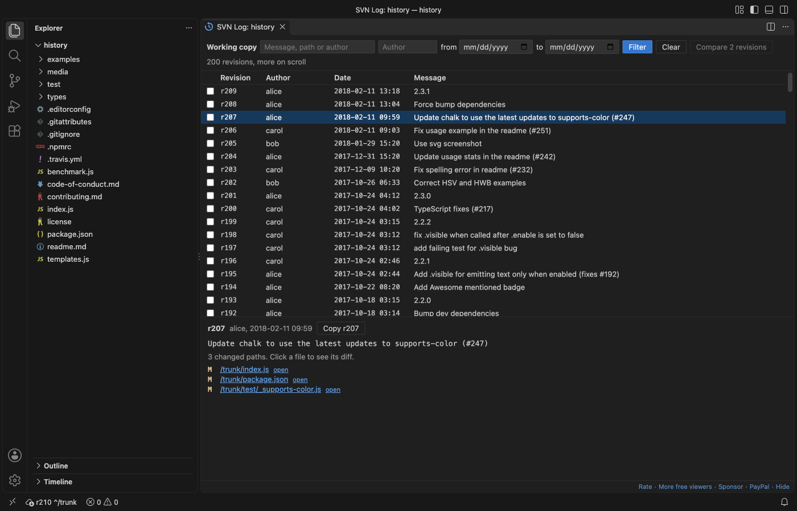
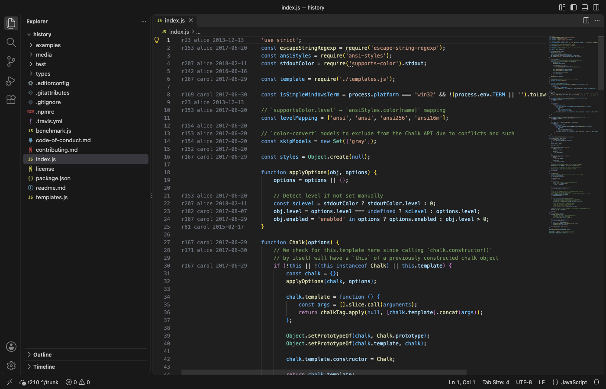
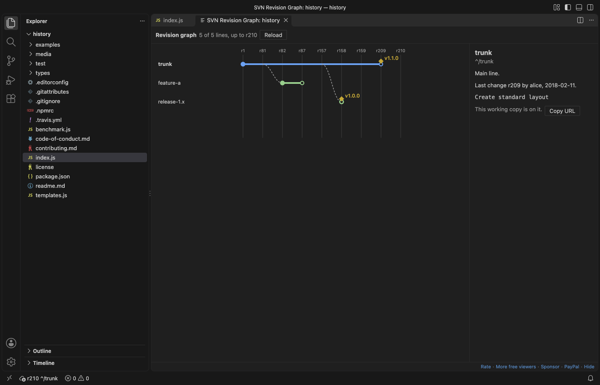

# SVN Client & Subversion Source Control (Commit, Blame, Log, Diff)

Free SVN client for VS Code. It runs the `svn` command line you already have, so it works with any Subversion server you can reach today. Free, no sign-in, works offline: the extension itself sends nothing anywhere, and only `svn` talks to your own repository server.

*Real output from VS Code 1.142 on macOS with svn 1.15.0. The working copy comes from `scripts/make-fixtures.sh`. `scripts/gate-vscode.mjs` installed the packaged extension in a clean VS Code profile, clicked util.js in the Source Control view and saved the window.*

- Commit, update and diff from the Source Control view. Changes, Unversioned, Conflicts and each changelist get their own group, and the gutter marks changed lines against BASE.
- History and blame without leaving the editor. The log view pages through the history with filters for text, author and date, and blame shows who changed each line.
- It stays light on big working copies. Only one `svn status` runs per working copy at a time, file events are bundled into one run, and build folders can be left out.

## Quick start

1. Have the svn command line. Check with `svn --version` in a terminal. If it is missing, SVN Client shows an install page with the command for your system (Homebrew, apt, dnf, TortoiseSVN command line tools, SlikSVN).
2. Open a folder that was checked out with svn, or run "SVN: Checkout..." with a repository URL. The working copy shows in the Source Control view.
3. Type a message and press Ctrl+Enter (Cmd+Enter on macOS) to commit.

"SVN: Get Started" in the Command Palette opens a short tour.

## Why this one

People who use SVN extensions in VS Code have written about these problems in Marketplace reviews. This extension was built and tested against each one:

| What people wrote | What SVN Client does | Measured |
|---|---|---|
| "Starts dozens of svn instances when building in the folder. Useless CPU hog" ([review, 2020-07-07](https://marketplace.visualstudio.com/items?itemName=eliean.vscode-svn&ssr=false#review-details)) | File events only ask for a refresh. Many events become one `svn status`, and a second status never starts while one runs. Excluded folders (node_modules, build, dist, target, out) start no status at all. | In the real VS Code gate, a script wrote 5,000 files into a 100,000-file working copy while `ps` checked every 50 ms: never more than 1 `svn status` at a time, 2 status runs in all. |
| "it generates multiple projects. Same change file, different project names." ([review, 2025-02-19](https://marketplace.visualstudio.com/items?itemName=johnstoncode.svn-scm&ssr=false#review-details)) | Each working copy root is found once, by the root that `svn info` reports, however many workspace folders sit inside it. Nested working copies and externals get their own entry, labelled by path. | Gate: a working copy with a separate checkout nested inside it, opened as 2 workspace folders, shows 2 entries (outer and nested). An externals folder gets its own entry. |
| "I have installed tortoiseSVN but error Svn installation not found." ([review, 2018-10-03](https://marketplace.visualstudio.com/items?itemName=johnstoncode.svn-scm&ssr=false#review-details)) | SVN Client looks on PATH and in the usual install folders (Homebrew, /usr/local, TortoiseSVN, SlikSVN, CollabNet, VisualSVN). When svn is missing it shows one page with the install command and a Retry button, not a loop of error messages. | Gate: with svn missing, one install page opened and no error message showed. The Windows folders are covered by unit tests, not by a Windows run. |

A server that does not answer is stopped after a time limit with a message (`zovoSvn.networkTimeoutSec`), so VS Code never waits on a dead connection. In the gate, with the limit at 8 s, Update against an address that never answers stopped after 8.9 s with that message, and VS Code stayed responsive.

## Features

### Source Control

| Group | What is in it |
|---|---|
| Conflicts | Text, property and tree conflicts. Commit waits until they are resolved. The helper files svn writes next to a conflict (`.mine`, `.r12`, `.merge-left.r2`) are not listed as unversioned. |
| Changes | Modified, added, deleted, replaced and missing files (deleted outside svn), and property changes |
| Changelist: name | One group per svn changelist, with its own Commit button |
| Unversioned | New files, with Add and Add to svn:ignore |

Buttons and menus: Commit, Commit Selected Files, Commit Changelist, Update, Update to Revision, Revert (with a confirmation; unversioned files go to the trash), Add, Delete, Add to svn:ignore, Resolve (mark resolved, mine, theirs, base), Move to Changelist, Cleanup and Refresh. Explorer and editor tabs show the M, A, D, ?, ! and C letters.

### Diff

Click a changed file to compare it with its BASE revision. BASE comes from svn's own pristine copy, so it needs no network. Files with svn:keywords show the same expanded `$Id$` on both sides. Binary files and files over `zovoSvn.maxDiffMB` (20 MB) get a short note instead of a text diff, with buttons to open the file or its history. Nothing is loaded until you ask.

### Log

"SVN: Show Log" for the working copy, or "Show File History" from the editor or Explorer menu for one file or folder.

- 100 revisions per page, more as you scroll
- Filter by text, author and date range (`svn log --search` on the server, so it covers the whole history)
- The full message and the changed paths of a revision. Click a path to see its diff, or "open" to see the file at that revision.
- Tick two revisions and press Compare to see what changed between them

### Blame

"SVN: Toggle Blame" puts the revision, author and date before every line. Hover a line for the commit message and a link to all changes of that revision. Lines you changed and did not commit say "not committed". Set `zovoSvn.blame.mode` to `inline` to show it only after the line the cursor is on.

### Branches and tags

- Switch to trunk, a branch or a tag, picked from a list read from `branches/` and `tags/` next to your working copy
- Create a branch or a tag from HEAD, from your working copy revision, or from the working copy with its local changes
- Merge from a branch: every revision not merged yet, or a list like `120,125-130`. A dry run shows what would change, and the exact `svn merge` command shows before anything runs.
- The revision graph draws trunk, branches and tags over time

### Shelving

"SVN: Shelve Changes" saves your local changes as a patch in the extension's storage and reverts the files. "SVN: Unshelve" brings them back with `svn patch`. It works with every svn from 1.7, not only with the experimental shelving of svn 1.10 to 1.14. Binary changes cannot go into a text patch, so a shelf with them is refused before any file is touched.

### Changelists

The SVN Changelists view in the Source Control side bar lists each changelist and its files. Drag files from it or from the Explorer onto a changelist to move them there, or onto "No changelist" to take them out.

## Large working copies

- One `svn status` per working copy at a time, after `zovoSvn.statusDelayMs` (1 second) of quiet. A build that writes thousands of files causes one or two status runs, not thousands.
- `zovoSvn.exclude` keeps build folders out: changes there start no status, and unversioned files there are not listed.
- `zovoSvn.statusDepth` limits how deep status looks, for very large trees you only change near the top.
- Each group lists at most `zovoSvn.maxListedFiles` (5,000) files. The count stays exact.
- Status skips externals, which get their own entry, so one slow external does not hold up the rest.
- Measured in the real VS Code gate: a working copy with 100,000 files showed its changes 4.9 s after VS Code started. A 300 MB binary file is listed as modified and gets a short note instead of a text diff.

## Settings

| Setting | Default | What it does |
|---|---|---|
| `zovoSvn.path` | empty | Full path of svn. Empty: PATH and the usual install folders. A workspace cannot set it. |
| `zovoSvn.statusDelayMs` | 1000 | Quiet time before one status run |
| `zovoSvn.statusDepth` | infinity | infinity, immediates, files or empty |
| `zovoSvn.exclude` | node_modules, .git, build, dist, target, out, .gradle, `__pycache__` | Folders that start no status and whose unversioned files are not listed |
| `zovoSvn.detectDepth` | 3 | Folder levels searched for nested working copies |
| `zovoSvn.showUnversioned` | true | Show the Unversioned group |
| `zovoSvn.maxListedFiles` | 5000 | Most files listed per group |
| `zovoSvn.maxDiffMB` | 20 | Larger files open without a text diff and without gutter marks |
| `zovoSvn.commandTimeoutSec` | 120 | Time limit for local commands |
| `zovoSvn.networkTimeoutSec` | 300 | Time limit for update, commit, log, blame, switch and merge |
| `zovoSvn.statusTimeoutSec` | 300 | Time limit for svn status |
| `zovoSvn.blame.mode` | gutter | gutter or inline |
| `zovoSvn.blame.maxMB` | 10 | Largest file for blame |
| `zovoSvn.log.pageSize` | 100 | Revisions per page in the log |
| `zovoSvn.refreshOnFocus` | true | One status run when the window gets focus |
| `zovoSvn.askForRating` | true | Ask once for a Marketplace rating after the extension worked for you on 2 separate occasions. "Later" asks one more time after 7 days, "No thanks" never again. Never after an error. |
| `zovoSvn.showSupportLinks` | true | The small Rate, More free tools and Sponsor links at the bottom of the log view |

## Privacy and safety

- The extension makes no network calls and has no telemetry. Only `svn` talks to your repository server, the same as in a terminal.
- Passwords are never stored by this extension. Commands run in svn's non-interactive mode, so svn never waits at a password prompt and uses its own credential cache. If the server asks for a login, the message tells you to run `svn info` once in a terminal.
- svn runs without a shell, with each path as a separate argument, so names with spaces, quotes, `@` or a leading dash are safe.
- In Restricted Mode a workspace cannot change `zovoSvn.path`, so a folder you open cannot make the extension run another program.
- Webviews run under a strict Content Security Policy with no remote sources, and text from svn is shown as plain text.

## Free and Pro

Every feature above is free in this version. A later version may offer Zovo Pro for the revision graph, shelving and the changelist manager. Zovo Pro is USD 19 once on [GitHub Sponsors](https://github.com/sponsors/theluckystrike/sponsorships?tier_id=679878) and unlocks the Pro features in every Zovo VS Code extension. Status, commit, diff, update, log, blame, branches and merge stay free for good. There are no ads, no countdown and no popups.

## Limits

- It needs svn 1.7 or later on your computer. It does not bundle svn.
- It does not do `svn relocate`, `svn import` or `svn export` yet. Run those in a terminal.
- Property changes are listed, and the diff view shows file text only. Use `svn diff` in a terminal for property diffs.
- Locks (`svn lock`) show in svn's own output only.
- Tested on macOS with svn 1.15.0 and VS Code 1.142. Windows and Linux paths are covered by unit tests only.

## Not affiliated

SVN Client is an independent extension by Zovo. It is not made by, and does not replace, any other publisher's SVN extension. Subversion is a trademark of the Apache Software Foundation.

## Support Zovo

Zovo extensions are free, with no ads and no tracking. They are made by [theluckystrike](https://github.com/theluckystrike) on GitHub. If this one saves you time, you can support the work:

- [Sponsor on GitHub](https://github.com/sponsors/theluckystrike)
- [PayPal](https://www.paypal.com/paypalme/najzzz)
- [Follow theluckystrike on GitHub](https://github.com/theluckystrike)

## More tools by Zovo

- [ZIP Viewer & Archive Explorer (JAR, TAR, GZ)](https://marketplace.visualstudio.com/items?itemName=zovo.zip-archive-explorer) browses ZIP, JAR, VSIX, TAR and GZ files, opens entries in tabs and extracts them safely.
- [Hex Viewer & Binary Viewer, Hex Editor (Large Files)](https://marketplace.visualstudio.com/items?itemName=zovo.zovo-hex-viewer) Hex viewer, binary viewer and hex editor for VS Code that opens files of any size (4 GB and more) in under a second. Insert and delete bytes, compare two files byte by byte, go to offset, find hex or text, a data inspector, copy as C array or base64. Free, works offline.
- [Large JSON Viewer, JSON Browser & JSON Tree](https://marketplace.visualstudio.com/items?itemName=zovo.zovo-json-tree-viewer) shows large JSON files as a searchable tree, copies JSONPath and turns arrays of objects into a table.
- [SQLite Viewer & SQLite3 DB File Browser, Database Explorer](https://marketplace.visualstudio.com/items?itemName=zovo.sqlite-table-viewer) browses SQLite tables read-only and runs SELECT queries.
- [Graphviz Viewer & DOT Viewer (Live Preview)](https://marketplace.visualstudio.com/items?itemName=zovo.zovo-graphviz-preview) shows a live preview of DOT files and exports SVG or PNG.

See [all Zovo extensions on the Marketplace](https://marketplace.visualstudio.com/publishers/zovo).

## License

MIT. No third-party code is bundled.
